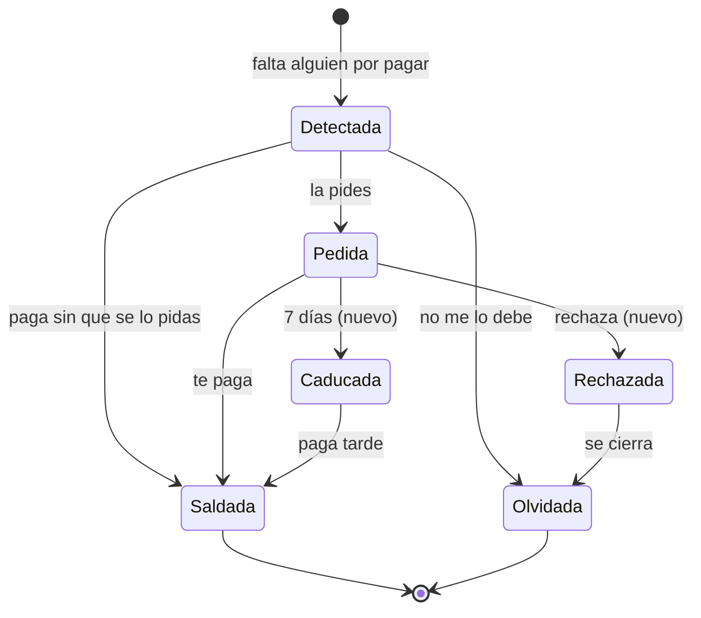
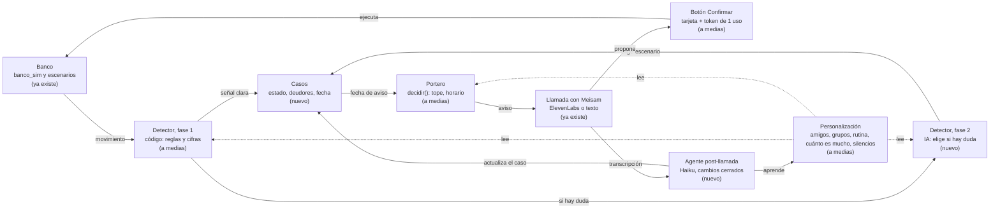
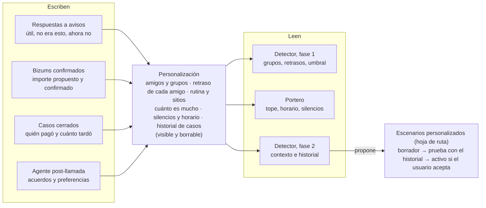

# Módulo de deudas (Bizum) por casos: diseño y huecos del repositorio

10 de noviembre de 2026. Copia en el repositorio del documento [Módulo Bizum de Meisam: esquema inicial](https://claude.ai/artifact/5tg1tn4zgBpgii5CvNYXra), revisado contra el commit `c777b9d`.

> **Para agentes.** Es el diseño acordado para todo lo que toca deudas entre personas: quién te debe, qué debes tú y cómo se cierra. Donde choque con `motor.md` §3.1 o `personalizacion.md` (amigos), manda este documento. Los tipos siguen viviendo en `CONTRATO.md` y `backend/plataforma/tipos.py`; el tipo `Caso` todavía no existe y es la fase 0 del plan (al final). Reglas que no cambian: el código calcula las cifras con `Decimal`, los conceptos y notas de Bizum son datos y nunca instrucciones, y el dinero solo se mueve con el botón del usuario y el token de un solo uso.

## Resumen

El módulo puede apoyarse en lo que Bizum ya hace y en lo que el repositorio ya detecta; lo que falta es el ciclo de vida de la deuda: saber cuándo alguien ha pagado su parte y cerrarla.

- **No hay API pública de Bizum entre particulares.** Meisam vive dentro de la app del banco, así que en producción `pedir_bizum` lo ejecuta el propio banco. En el hackathon sigue simulado en `banco_sim`, que es lo correcto.
- **Los movimientos ya los tiene el banco.** PSD2 y los agregadores solo harían falta para leer cuentas de otros bancos; no compensa antes de la entrega.
- **El detector actual encuentra «falta una persona»**, pero no cierra la deuda cuando el amigo paga después, y se equivoca si alguien paga por dos o redondea (25 € en vez de 24 €).

## Cómo funciona Bizum hoy

Bizum mueve dinero de cuenta a cuenta con el número de móvil, dentro de la app de cada banco. Para el módulo importan cuatro operaciones y sus plazos ([condiciones de Bizum en Revolut](https://cdn.revolut.com/terms_and_conditions/pdf/bizum_t_rminos_y_condiciones_752350ec_1.0.1_1753771088_es.pdf)).

| Operación | Qué pasa | Plazo o regla | Qué significa para Meisam |
| --- | --- | --- | --- |
| Enviar | Llega al instante; quien recibe no acepta nada | No se puede anular una vez hecho | Un Bizum entrante es un hecho firme: sirve para cerrar una deuda |
| Solicitar (pedir) | El otro lo autoriza o lo rechaza; quien pide puede cancelarlo | Caduca a los 7 días naturales | La deuda pasa a «pedida» y, sin Bizum en 7 días, a «caducada» |
| Envío o solicitud múltiple | Hasta 30 personas a la vez | Mismo importe y mismo concepto para todos | Vale para cuotas iguales; con cuotas distintas, una solicitud por persona |
| Enviar a quien no tiene Bizum | Le llega una invitación para darse de alta | Cobra si se da de alta en 2 días | La acción simulada ya responde «no tiene Bizum activo» |

**Límites entre particulares.** Son los máximos del sistema; cada banco puede fijar topes menores.

| Límite | Valor |
| --- | --- |
| Importe por operación | 0,50 € a 1.000 € |
| Enviado al día / al mes | 2.000 € / 5.000 € |
| Recibido al día | 2.000 € |
| Operaciones recibidas al mes | 60 |
| Solicitudes al mes | 60 |

**Identidad.** El identificador es el móvil. Bizum asigna un alias con el nombre y las iniciales de los apellidos ([condiciones de Monzo](https://monzo.com/es/legal/terminos-y-condiciones-bizum)), y cada usuario ve el nombre con el que guardó el contacto. En el extracto la contraparte puede llegar como nombre completo o como alias; la clave del repo (nombre + inicial del primer apellido) encaja con ambos.

**Concepto.** Lo escribe quien envía y es texto libre. Es un dato no fiable: puede traer instrucciones, así que sigue marcado como dato y nunca decide nada por sí solo.

**Novedades de 2026 que afectan al módulo**

- **Bizum Pay en tiendas físicas**, desde el 18 de mayo de 2026 y de forma escalonada: se paga con cargo a la cuenta o con una tarjeta guardada en la app ([OCU](https://www.ocu.org/dinero/cuenta-bancaria/consejos/bizum-pay-tiendas)). La cena ya no siempre llega como «COMPRA TARJETA».
- **Bizum fuera de España**: pagos con Italia, Portugal y Andorra desde marzo de 2025, y un acuerdo de febrero de 2026 con Wero y Vipps MobilePay para llegar a 13 países ([AEB](https://aebanca.es/en/actualidad/notas-de-prensa/banking-associations-aeb-ceca-and-unacc-welcome-the-launch-of-bizums-interconnection-with-13-european-countries/)). Un amigo de Erasmus podría devolver desde otra plataforma, con otro formato de contraparte.
- **Hacienda**: desde 2026 los bancos informan de los cobros por Bizum de actividades económicas; entre particulares no cambia nada. Meisam no debe tratar los Bizums de amigos como ingresos.

## Herramientas que podemos usar

Para el hackathon basta con lo que ya hay en el repositorio; las APIs externas solo cuentan para explicar al jurado cómo sería en producción.

| Herramienta | Qué da | ¿Nos sirve? |
| --- | --- | --- |
| API de Bizum entre particulares | No hay ninguna pública: enviar y pedir solo se hace desde la app de un banco adherido | Es justo el papel del banco cliente: en producción, Meisam llama a su función de Bizum. En el hackathon, `banco_sim` |
| Bizum para comercios ([Redsys](https://www.cajamar.es/storage/documents/6296/configura-bizum-en-tu-tpv-virtual-gcc.pdf), [MONEI](https://docs.monei.com/apis/rest/bizum/), Stripe, Checkout.com) | Cobrar compras en una web; el comercio necesita un banco adquirente | No: cobra a clientes, no pide dinero a un amigo |
| [Hub PSD2 de Redsys](https://redsys.es/en/psd2.html) | Leer cuentas y movimientos de casi todos los bancos españoles, con consentimiento | Solo desde fuera del banco y con licencia de información de cuentas. No para el hackathon |
| Agregadores (Tink, TrueLayer, Yapily, [Enable Banking](https://enablebanking.com/docs/markets/es/)) | Lo mismo con una sola integración, de pago | Igual que el anterior. [GoCardless Bank Account Data](https://actualbudget.org/docs/advanced/bank-sync/gocardless/) no admite cuentas nuevas desde julio de 2025 |
| `backend/datos/importar_csv.py` (ya existe) | Extractos con «BIZUM RECIBIDO DE …» | Sí: plan B creíble para la demo con un extracto sintético |
| Escenarios YAML etiquetados (ya existen) | Historias con Bizums, notas y trampas, medibles con `/medir` | Sí: la herramienta principal para el algoritmo |
| Haiku 5.5 por `claude_client.py` | Clasificar y razonar sobre casos dudosos y resumir llamadas | Sí, siempre con los datos marcados y sin calcular importes |
| ElevenLabs (ya integrado) | La llamada que propone pedir el Bizum | Sí, ya está |

La competencia directa ya reparte gastos con Bizum, pero todas piden apuntar el gasto a mano: [grupos de BBVA](https://www.bbva.es/general/app-compartir-gastos.html), [imagin&Split](https://www.imagin.com/en/imaginsplit-split-bills-app), el reparto de recibos de CaixaBank, N26 y Revolut.

## Qué hay ya en el repositorio

La detección de «falta una persona» funciona de principio a fin (commit `c777b9d`, 9 nov); el seguimiento de la deuda después del aviso está sin hacer.

| Pieza | Archivo | Qué hace hoy | Estado |
| --- | --- | --- | --- |
| Normalización | `backend/motor/normalizar.py` | Deduce el canal `bizum` del concepto y la clave de contraparte (`LAURA MARTINEZ GARCIA` → `LAURA M`) | Hecho |
| Emparejar pago y Bizums | `backend/motor/reparto.py` | Asigna cada Bizum o transferencia recibidos al pago con tarjeta más reciente de los 7 días anteriores cuya cuota encaje | Hecho, solo cuotas iguales |
| Detector | `backend/motor/detectores/gasto_compartido.py` | Avisa si faltan personas; candidatos = quienes suelen pagar con el mismo grupo | Hecho |
| Grupos y retrasos | `backend/personalizacion/perfil.py` | Aprende los grupos de amigos y cuánto tardan en devolver (p75) | Hecho |
| Módulo | `backend/modulos/catalogo/cena_compartida.yaml` | Propone `pedir_bizum` a cada candidato (tope = cuota) y `recordar` en 3 días | Hecho |
| Acción | `backend/acciones/registro.py` | Simula la solicitud en estado `pendiente`; se puede cancelar mientras siga pendiente | Hecho, sin aceptar, rechazar ni caducar |
| Saldo con cada amigo | `Amigo` en `backend/plataforma/tipos.py`, `observar` en `backend/personalizacion/__init__.py` | Estados `detectado`, `pedido`, `saldado`, `olvidado` definidos; `observar` no hace nada | *Stub* (tarea O7 del plan) |

**Prueba rápida (10 nov).** Cinco variantes de `cena-lucia` por el motor real, sin tocar el repositorio:

| Variante | Resultado | ¿Correcto? |
| --- | --- | --- |
| Base: Marcos no paga | Faltan 1, 24 €, candidato Marcos, confianza 0,95 | Sí |
| Marcos paga el 8/11, antes del aviso | Sin aviso | Sí |
| Marcos paga el 11/11, después del aviso | El aviso del 9/11 sale y nada lo cierra luego | Falta el cierre |
| Daniel paga 48 € por él y por Marcos | Faltan 2, 48 €, candidatos Daniel y Marcos, confianza 0,85 | **No**: no falta nadie |
| Sara redondea a 25 € | Faltan 2, 48 €, candidatos Marcos y Sara, confianza 0,85 | **No**: falta 1 y Sara ya pagó |

Los dos fallos superan el umbral del módulo (0,7), así que pedirían dinero a quien ya ha pagado. La causa: un Bizum cuyo importe no es una cuota exacta no se asigna al pago y se cuenta como si esa persona no hubiera pagado. Estas cinco variantes deberían convertirse en escenarios YAML etiquetados.

## Ciclo de vida de una deuda

Una deuda solo se cierra cuando llega su Bizum o el usuario la descarta. Hoy solo existen el aviso (Detectada) y la solicitud simulada (Pedida); nada mueve la deuda después.

Huecos, por orden de impacto en la demo:

1. **Cerrar la deuda** (`observar`, tarea O7): un Bizum entrante de la misma contraparte por la cuota (± 0,50 €), en cualquier fecha posterior y con cualquier concepto, la marca como saldada.
2. **Importes que no son una cuota**: múltiplos (48 € = 2 cuotas) y redondeos (25 € por 24 €). Hoy dan avisos falsos con confianza 0,85. Idea: asignar el Bizum si es k × cuota con k ≤ 3, o si queda a ≤ 1 € de ella; un múltiplo cuenta como k personas. Si no está claro quién es el acompañante, el caso queda dudoso y lo resuelve la fase 2.
3. **Estados de la solicitud**: aceptada, rechazada y caducada a los 7 días, en `banco_sim` y en el caso; después, recordar o volver a pedir una sola vez.
4. **Cena pagada con Bizum Pay**: `es_pago` solo acepta `canal == "tarjeta"`, así que un pago con cargo a la cuenta no se ve.
5. **Reglas de Bizum en la acción**: importe entre 0,50 € y 1.000 €, como mucho 60 solicitudes al mes y una sola solicitud abierta por amigo y deuda.
6. **Lo que debes tú**: una solicitud recibida y sin pagar a punto de caducar. No sale en el extracto, solo la conoce el banco; encaja como evento del banco simulado.
7. **Fuera del MVP**: cuotas desiguales, Bizums que llegan antes del pago y homónimos con la misma clave (`LAURA M`). En producción, la clave sería el móvil cifrado.

## Del diseño por casos al repositorio

### Conceptos

- **Escenario**: la «clase». Una situación de deuda con su regla de entrada en código, su regla de cierre y su caducidad. Ejemplos: gasto compartido puntual, viaje, gasto fijo compartido cada mes, préstamo a un amigo, te pidieron un Bizum y no lo has pagado. Ojo: en el repo, «escenario» también son los YAML de prueba de `backend/escenarios/`; aquí lo usamos para los tipos de deuda.
- **Caso**: el «objeto». Se crea cuando pasa algo real (la cena del viernes en La Tasca) y guarda escenario, hipótesis, hechos, deudores con su estado, `avisar_desde`, urgente, acuerdos, conversaciones e historial de cambios.
- **Fase 1 del detector (código)**: cada movimiento nuevo pasa por ella. Primero actualiza los casos abiertos (el Bizum de Marcos salda su parte); después prueba las reglas de entrada de cada escenario, filtradas por tipo de movimiento. Si la señal es clara, asigna el escenario; si encajan varios o la confianza es media, deja el caso como dudoso con sus hipótesis; si es débil, no crea nada.
- **Fase 2 del detector (agente IA)**: solo para casos dudosos. Elige escenario y candidatos con el contexto del usuario y decide cómo preguntar («¿es esto o esto?»). El código valida su salida.
- **Portero (código, sin IA)**: decide si un caso que ha llegado a su fecha se notifica ahora, va al resumen o espera, con las reglas de la personalización.
- **Agente post-llamada**: lee la conversación completa al colgar y aplica cambios de una lista cerrada al caso y a la personalización. Nunca mueve dinero ni cambia importes.

El código pone los números; la IA pone el contexto.

### Mapa: qué existe y qué falta

El dinero solo se mueve por el camino llamada → botón → banco; la conversación va por el agente post-llamada y solo cambia contexto.

| Pieza del diseño | Qué hay hoy | Qué hay que cambiar | Archivos |
| --- | --- | --- | --- |
| Detector, fase 1 (código) | Cada detector es un tipo de momento registrado con `@registrar`; solo `gasto_compartido` trata deudas. Ya lee parte de la personalización (grupos, retrasos, ticket típico) | Un escenario = un detector. Leer la personalización para elegir y ajustar escenarios; arreglar múltiplos y redondeos; actualizar los casos abiertos con cada movimiento; si la señal es clara, asigna el escenario; si encajan varios o la confianza es media, deja el caso como «dudoso» con sus hipótesis | `motor/detectores/`, `motor/reparto.py`, `motor/parametros.py`, `motor/__init__.py` |
| Detector, fase 2 (agente IA) | No existe. Hoy Claude solo entra en la búsqueda de comercios (`motor/conocimiento.py`) | Para cada caso dudoso, Haiku por `claude_client.py` recibe los hechos que calculó el código, las hipótesis, la personalización y el historial con esos contactos, con los conceptos marcados como datos. Devuelve, con salida estructurada: escenario de la lista, confianza, candidatos y cómo preguntar. El código comprueba que el escenario existe y que las cifras son las suyas; si falla o no hay red, se queda la fase 1. Corre después de `procesar`, como la búsqueda de comercios, así el motor sigue sin Claude en el camino caliente | `motor/dudas.py` (nuevo), `plataforma/orquestador.py` |
| Caso | No existe. `Momento` se emite una vez y no cambia (`claves_emitidas`); `Amigo` tiene estados pero nada los mueve | Tipo nuevo `Caso`: escenario, hipótesis, hechos, deudores con su estado, `avisar_desde`, urgente, acuerdos, conversaciones e historial de cambios. El `Momento` sigue siendo «se abre un caso», así `/medir` y los tests actuales valen | `plataforma/tipos.py`, `docs/diseno/CONTRATO.md`, paquete nuevo `casos/` |
| Fecha de aviso | El detector espera p75 + 1 días antes de emitir | El caso nace con la primera señal y guarda `avisar_desde`; si entra el Bizum antes, se salda sin avisar | `casos/`, `plataforma/orquestador.py` |
| Portero | `decidir` ya aplica módulo activo, silencios, franja de 9 a 22 h, tope de 2 avisos al día, urgencia alta y resumen | Pasarlo cada día por los casos que llegan a su fecha, no solo por los momentos nuevos; agrupar por contacto; lo que va al resumen vuelve a la cola | `personalizacion/politica.py`, `plataforma/orquestador.py` |
| Respuesta al aviso | `registrar_feedback` → `aprender`; ignorada a las 48 h | Que también mueva el caso: «no me lo debe» lo cierra, «ahora no» lo pospone, y la respuesta a «¿es esto o esto?» resuelve la duda | `plataforma/orquestador.py`, `casos/` |
| Conversación | La transcripción solo vive en el navegador (`onMessage` en `Llamada.tsx`) | Enviarla al backend al colgar y guardarla en el caso, enmascarada y borrable | `frontend/components/Llamada.tsx`, `api/rutas_voz.py` |
| Tarjeta editable | Solo tiene la casilla de bloquear cobros; el servidor rechaza un importe mayor que la cuota u otra persona (`acciones/__init__.py`, líneas 61-64) | El límite frena lo que prepara Meisam; el usuario cambia importe y concepto antes de confirmar, validado con las reglas de Bizum (0,50 a 1.000 €). El caso guarda lo propuesto y lo confirmado | `acciones/__init__.py`, `frontend/components/TarjetaAccion.tsx` |
| Agente post-llamada | No existe | Haiku por `claude_client.py` con salida estructurada de una lista cerrada (posponer, nota, silenciar contacto, proponer corrección de deudores); el código valida y nunca toca importes ni pagos | `casos/resumir.py` (nuevo) |
| Personalización que crece | Ya aprende de las respuestas (`aprender`) y de las acciones confirmadas (`registrar_accion`); grupos y retrasos se recalculan cada 7 días desde los movimientos; `observar` es un *stub* | Sumar los casos cerrados (quién pagó, cuánto tardó, propuesto frente a confirmado) y lo que extrae el agente post-llamada, y dárselo a las dos fases del detector. Todo visible y borrable en «Lo que he aprendido» | `personalizacion/`, `ModeloUsuario` en `plataforma/tipos.py` |
| Escenarios personalizados (hoja de ruta) | No existe; los módulos ya tienen borrador, prueba en seco y aprobación | La fase 2 propone un escenario del usuario rellenando los parámetros de una regla existente; se prueba sobre su historial y se activa si el usuario lo acepta | `motor/`, reutilizar la prueba en seco de `modulos/` |
| Pistas del usuario (chat, WhatsApp) | El chat solo existe dentro de un aviso | Para el hackathon, como mucho un botón «Esto era compartido»; chat libre y WhatsApp, hoja de ruta | — |

Recomendación: un `Caso` nuevo que agrupe el `Momento`, sus `Propuesta`s y los deudores, en vez de estirar `Amigo`: cambia menos el contrato y no rompe lo que ya está en verde.

### La personalización crece con todo

La personalización es una base de datos que se alimenta de cada interacción, no solo de la llamada, y el detector la usa desde la fase 1 para elegir y ajustar escenarios.

- **Quién escribe:** las respuestas a los avisos (ya existe, `aprender`), los Bizums confirmados con lo propuesto y lo confirmado (a medias, `registrar_accion`), los casos cerrados (nuevo) y el agente post-llamada (nuevo).
- **Cómo la usa el detector:** la fase 1 ajusta umbrales, espera y candidatos con grupos, retrasos y qué es mucho (ya pasa con `ajustar` en `motor/parametros.py`); la fase 2 lee además el historial de casos y las conversaciones resumidas.
- **Escenarios personalizados:** cuando la fase 2 ve un patrón que se repite («los domingos en La Tasca pagas tú y Ana te devuelve la mitad»), propone un escenario solo para ese usuario. No escribe código: rellena los parámetros de una regla que ya existe (comercio, día, grupo, reparto). Se prueba sobre su historial, como la prueba en seco de los módulos, y solo se activa si el usuario lo acepta.

### Seguridad del dinero

- Meisam solo prepara acciones de la lista cerrada; la tarjeta llega rellena con su propuesta y el usuario puede editar importe y concepto antes de pulsar «Confirmar».
- La orden va de la app al banco con el token de un solo uso; el agente de ElevenLabs nunca ve el token ni ejecuta nada.
- El resultado del banco es la fuente de verdad del caso. La conversación solo añade contexto (fechas, notas, silencios) y nunca cambia importes ni marca pagos.
- Guardar conversaciones y patrones sobre terceros («Miguel suele faltar») es sensible: todo visible y borrable.

## Siguiente paso propuesto

Hasta la congelación (11 nov, 14:00) caben el caso con su ciclo de vida, la tarjeta editable, el detector en dos fases y una versión simple del agente post-llamada; un segundo escenario, solo si sobra tiempo. Las horas son estimaciones.

| Fase | Tarea | Zona y subagente | Se comprueba con | Horas |
| --- | --- | --- | --- | --- |
| 0, un solo hilo | Tipo `Caso` (con hipótesis) en `tipos.py` y en `CONTRATO.md`, y su almacén en el orquestador | plataforma · sesión principal | `pytest` sigue en verde | 0,5 |
| 1, en paralelo | Detector fase 1: múltiplos y redondeos en `reparto.py`, casos dudosos con hipótesis y paso que salda casos con cada Bizum entrante | motor · `ingeniero-deteccion` | `/medir motor`: «paga por dos» y «redondea» sin avisos falsos (o como dudosos); «Marcos paga el 11», caso saldado | 2 |
| 1, en paralelo | Paquete `casos/`: crear, posponer y cerrar; portero diario sobre los casos con fecha; respuesta al aviso → caso | personalizacion · `programador` + `cientifico-personalizacion` | Tests de ciclo de vida y `/medir personalizacion` | 2,5 |
| 1, en paralelo | Tarjeta editable (importe y concepto) con reglas de Bizum; el caso guarda propuesto y confirmado | modulos y frontend · `ingeniero-modulos` + `frontend` | `pytest tests/test_acciones.py` y la app arrancada | 1,5 |
| 2, en paralelo | Detector fase 2: agente de dudas con Haiku y salida estructurada; la pregunta «¿es esto o esto?» en la notificación | motor · `ingeniero-deteccion` + `ingeniero-agente` | Tests con el cliente falso y eval con un concepto que lleva una inyección | 2 |
| 2, en paralelo | Transcripción al backend al colgar y agente post-llamada (posponer, nota, silenciar) | voz · `ingeniero-voz` + `programador` | Eval con una transcripción que lleva una inyección: no cambia importes | 2 |
| 3, si sobra | Segundo escenario: gasto fijo compartido cada mes (alquiler, Netflix) | motor · `ingeniero-deteccion` | Escenario YAML nuevo con trampas | 1,5 |

La fase 2 del detector es la que más suma en «uso de IA frontera» (15 %): enseña que la IA razona con el contexto del usuario y el código pone los números. Hoja de ruta para el pitch: pesos que se aprenden, reglas por categoría de comercio, escenarios propuestos desde la personalización, Bizum Pay y chat o WhatsApp con Meisam.

**Decisiones de Pablo (10 nov)**

- [x] **Saldo con cada amigo: entra en la demo.** El sistema guarda quién debe a quién y cómo van las cuentas entre los dos (`/app/amigos`, `observar` deja de ser un *stub*). La tarea O7 pasa de opcional al MVP.
- [x] **Regla general: a la IA del detector (fase 2) va todo lo que el código no ve completamente claro.** El código solo decide solo cuando la señal es inequívoca (cuota exacta, una sola hipótesis). Cualquier otra cosa se queda como caso dudoso con sus hipótesis y la resuelve la fase 2 con el contexto del usuario.
- [x] **Alguien paga por dos (48 € = 2 cuotas):** el código lo marca como dudoso (no sabe quién es el acompañante) y la fase 2 decide con grupos e historial. Si la IA es segura, quita al acompañante sin preguntar al usuario: eso solo cambia a quién propone pedir dinero, y el usuario sigue confirmando con el botón. El aviso enseña la hipótesis y sus motivos («Daniel pagó 48 €: parece que incluye a Marcos») y se puede corregir. Si la IA no es segura, lo pregunta la llamada («¿Daniel pagó también lo de Marcos?»).
- [x] **Cuotas desiguales:** también a la fase 2. La IA valora la probabilidad con el contexto (p. ej. un restaurante suele ser «cada uno lo suyo») y decide entre avisar, preguntar o no avisar.
- [x] **Sin red o sin IA, los casos dudosos no avisan** (van al resumen o esperan). Es mejor no pedir dinero a quien quizá ya pagó y, sobre todo, **el usuario nunca debe recibir avisos absurdos ni spam de Meisam**: ante la duda, silencio. Esto manda sobre cualquier umbral de confianza (el 0,7 del módulo no basta para un caso dudoso).
- [x] **Aviso sin respuesta en 48 h:** el deudor sin solicitud pasa a «olvidada»; el caso sigue abierto, no se insiste y se salda solo si pagan después (Pablo, 10 nov).
- [x] **Foco del producto:** un Meisam que quita al usuario la carga de estar pendiente de quién le debe dinero y de acordarse. Recortados el panel `/jurado` y la creación de módulos en directo.

## Fuentes

- [Condiciones de Bizum en Revolut](https://cdn.revolut.com/terms_and_conditions/pdf/bizum_t_rminos_y_condiciones_752350ec_1.0.1_1753771088_es.pdf): solicitudes, plazos, límites y envíos múltiples
- [Bankkers, límites de Bizum 2026](https://bankkers.com/?p=4036)
- [BBVA, límite de recepción de Bizum](https://www.bbva.es/finanzas-vistazo/tu-guia-bbva/transferencias/limite-recepcion-dinero-bizum.html)
- [Condiciones de Bizum en Monzo](https://monzo.com/es/legal/terminos-y-condiciones-bizum): alias con nombre e iniciales
- [OCU, Bizum Pay en tiendas](https://www.ocu.org/dinero/cuenta-bancaria/consejos/bizum-pay-tiendas)
- [AEB, interconexión de Bizum con 13 países](https://aebanca.es/en/actualidad/notas-de-prensa/banking-associations-aeb-ceca-and-unacc-welcome-the-launch-of-bizums-interconnection-with-13-european-countries/)
- [Redsys, hub PSD2](https://redsys.es/en/psd2.html) y [Enable Banking, open banking en España](https://enablebanking.com/docs/markets/es/)
- [Actual Budget, GoCardless sin altas nuevas](https://actualbudget.org/docs/advanced/bank-sync/gocardless/)
- [BBVA, grupos para compartir gastos](https://www.bbva.es/general/app-compartir-gastos.html) e [imagin&Split](https://www.imagin.com/en/imaginsplit-split-bills-app)
